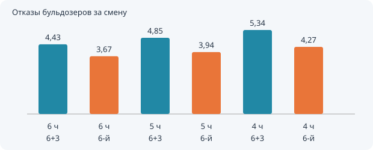
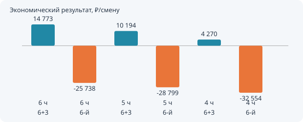

# v2. Влияние наработки бульдозера на отказы и экономику

В v1 сохранены исходные данные: математическое ожидание наработки бульдозера до отказа — 6 часов. В v2 доступны 6, 5 и 4 часа. Переключатель версии есть в меню и в панели звука; наработка v2 переключается перед запуском и в панели звука во время работы. При изменении наработки начинается новая смена. Оформление «Для опытных» работает независимо в обеих версиях. Настройки v1 и v2 хранятся отдельно.

## Связь математического ожидания и интенсивности

Модель предполагает экспоненциальное время исправной работы: P(T > t) = exp(−λt), E[T] = 1/λ. Следовательно, λ = 1/E[T]. Для 6 ч интенсивность равна 0,1667 ч⁻¹, для 5 ч — 0,2 ч⁻¹ (+20%), для 4 ч — 0,25 ч⁻¹ (+50%). Интенсивность относится к часу работы исправной машины. Это соотношение с постоянной интенсивностью справедливо для принятого экспоненциального распределения; среднее само по себе не задаёт постоянную интенсивность для любого распределения.

В каждый момент суммарная интенсивность отказов бульдозеров равна числу исправных бульдозеров, делённому на выбранную наработку. Во время ожидания и ремонта новая поломка этой машины не происходит. Поэтому E[N] = λ × E[суммарного времени исправной работы]. Оценки 3 × 16 / T = 8; 9,6; 12 за смену игнорируют простои и не являются результатом этой модели. Одна машина может отказать повторно после ремонта.

## Результаты

20 000 независимых 16-часовых смен на каждый сценарий, seed 2026, очередь FIFO, исходный парк из 20 машин (3 бульдозера). Каждая смена начинается с исправным парком. Меняется только наработка бульдозера; ставки, парк и ремонт остаются одинаковыми. Значения — средние за смену; ± означает половину 95% доверительного интервала среднего. Для разности к 6 ч используется парное сравнение смен с одинаковыми начальными seed. Это результаты имитации, а не гарантированные показатели отдельной смены.

| T, ч | λ, ч⁻¹ | Слесари | Отказы бульдозеров | Отказы всего парка | Результат, ₽ | Δ результата к 6 ч, ₽ |
|---|---|---|---|---|---|---|
| 6 | 0.1667 | Бригада 6+3 | 4.43 ± 0.02 | 31.61 ± 0.06 | 14773 ± 532 | 0 ± 0 |
| 6 | 0.1667 | Только 6-й | 3.67 ± 0.01 | 25.30 ± 0.04 | -25738 ± 434 | 0 ± 0 |
| 5 | 0.2000 | Бригада 6+3 | 4.85 ± 0.02 | 31.66 ± 0.06 | 10194 ± 521 | -4579 ± 217 |
| 5 | 0.2000 | Только 6-й | 3.94 ± 0.01 | 25.42 ± 0.04 | -28799 ± 429 | -3061 ± 133 |
| 4 | 0.2500 | Бригада 6+3 | 5.34 ± 0.02 | 31.66 ± 0.06 | 4270 ± 504 | -10502 ± 301 |
| 4 | 0.2500 | Только 6-й | 4.27 ± 0.01 | 25.54 ± 0.04 | -32554 ± 420 | -6817 ± 187 |

## Вывод

При снижении наработки бульдозера число его отказов растёт, а экономический результат ухудшается. Рост фактического числа отказов меньше роста λ: дополнительные поломки увеличивают простой, уменьшая время, когда возможен следующий отказ. Изменяется и загрузка очереди ремонта для остальных машин. При исходных параметрах сохранение бригады 6+3 экономически выгоднее одного слесаря 6-го разряда во всех трёх сценариях.

Сохранена формула исходной работы: результат = потенциальный доход − 2 × потери от простоя − содержание слесарей. Потери уменьшают заработанный доход и дополнительно вычитаются как штраф. Это именно учебная целевая функция исходной модели. Если нужен обычный денежный остаток без отдельного штрафа, он равен потенциальному доходу − потери − содержание; в данных JSON для этого доступны заработанный доход и содержание персонала.

## Как повторить

Откройте v2 → «Сравнить 6 / 5 / 4 ч» → выберите 20 000 смен → «Пересчитать». Расчёт использует текущие исходные данные и выбранную очередь; при изменении настроек таблица пересчитывается заново при открытии. CSV выгружается кнопкой. На время просмотра сравнения смена и речь стоят на паузе; закрытие восстанавливает прежнее состояние паузы. Ранее поставленная пользователем пауза сохраняется.

Готовая таблица: [CSV](results/comparison-v2.csv); полные оценки и интервалы: [JSON](results/comparison-v2.json). Графики доступны отдельными SVG. Генерация файлов: `node tools/generate-study.mjs`. Проверка математики и сохранности v1: `node tools/check-study.mjs`.
